# CrediYa  - Sistema de Prestamos y Cobros

Sistema de consola desarrollado en Java para digitalizar la gestion de empleados, clientes, prestamos, aprobaciones y pagos de **CrediYa**. La aplicacion usa MySQL mediante JDBC, sigue la arquitectura MVC con DAO y permite generar respaldos serializados.

## Contenido

- [Caracteristicas](#caracteristicas)
- [Tecnologias](#tecnologias)
- [Arquitectura](#arquitectura)
- [Modelo de negocio](#modelo-de-negocio)
- [Capturas del sistema](#capturas-del-sistema)
- [Requisitos e instalacion](#requisitos-e-instalacion)
- [Uso](#uso)
- [Patrones y conceptos aplicados](#patrones-y-conceptos-aplicados)
- [Estructura del proyecto](#estructura-del-proyecto)

## Caracteristicas

### Gestion de usuarios

- Registro, consulta, actualizacion y desactivacion logica de empleados.
- Registro, consulta, actualizacion y desactivacion logica de clientes.
- Inicio de sesion mediante documento y clave.
- Menus restringidos por rol: gerente, supervisor, asesor o cliente.
- Una misma persona puede tener perfil de empleado y cliente; al iniciar sesion puede elegir el perfil que desea usar.

### Gestion de prestamos

- Radicacion de prestamos asociando cliente y empleado radicador.
- Calculo de interes compuesto, monto total, cuota mensual y saldo pendiente.
- Politica configurable desde MySQL: montos, plazo, tasa y topes de aprobacion.
- Consulta general de prestamos, consulta por cliente y filtro por empleado radicador.
- Estados controlados: `PENDIENTE`, `ACTIVO`, `PAGADO`, `RECHAZADO` y `VENCIDO`.

### Aprobacion de creditos

- Flujo de aprobacion con el patron Chain of Responsibility.
- Asesor: aprueba prestamos desde $500.000 hasta $3.000.000.
- Supervisor: aprueba prestamos superiores a $3.000.000 y hasta $10.000.000.
- Gerente: aprueba prestamos superiores a $10.000.000 y hasta $100.000.000.
- Registro de radicacion, escalamiento, aprobacion y rechazo en el historial.

### Pagos y cartera

- Registro de abonos parciales o totales.
- Pago mixto: efectivo y transferencia en un mismo abono.
- Transferencias mediante PSE, Nequi, Bancolombia o Davivienda.
- Registro de referencia para transferencias.
- Actualizacion automatica del saldo y del estado `PAGADO` cuando se cubre la deuda.
- Historico de pagos por prestamo.

### Reportes y respaldos

- Prestamos activos y vencidos.
- Clientes morosos.
- Total prestado, total recaudado y saldo de cartera.
- Uso de Lambda y Stream API para filtrar y calcular reportes.
- Exportacion de empleados, clientes, prestamos y pagos a archivos serializados `.dat`.

## Tecnologias

| Tecnologia | Uso |
|---|---|
| Java 21 | Logica de negocio y aplicacion de consola |
| Maven | Gestion de dependencias y compilacion |
| MySQL 8 | Persistencia relacional |
| JDBC | Conexion de Java con MySQL |
| NetBeans | IDE de desarrollo |
| Git y GitHub | Control de versiones y repositorio |

## Arquitectura

El proyecto utiliza MVC y DAO para separar responsabilidades:

```text
Vista (view)
    │ captura y muestra informacion en consola
    ▼
Controlador (controller)
    │ aplica reglas de negocio y coordina acciones
    ▼
DAO (dao)
    │ ejecuta consultas SQL mediante JDBC
    ▼
MySQL
```

El modelo representa las entidades del negocio:

```text
Persona (abstracta)
├── Empleado
└── Cliente

Prestamo
├── Pago
│   └── DetallePago
└── HistorialAprobacion
```

## Modelo de negocio

### Herencia de personas

`Persona` es una clase abstracta con los datos comunes: identificacion, nombre, correo, clave, estado y fecha de registro.

- `Empleado` hereda de `Persona` y agrega rol y salario.
- `Cliente` hereda de `Persona` y agrega telefono.

En MySQL se aplica una relacion equivalente: la tabla `persona` contiene la informacion comun y las tablas `empleado` y `cliente` contienen los datos particulares de cada perfil.

### Interes compuesto

El monto total del prestamo se calcula asi:

```text
Monto total = Capital x (1 + tasa mensual)^plazo
Interes total = Monto total - Capital
Cuota mensual = Monto total / plazo
```

Todos los valores monetarios se almacenan como `DECIMAL` en MySQL.

## Capturas del sistema

### Conexion a MySQL e inicio de sesion

Muestra la consola con el mensaje de conexion exitosa y el menu de inicio de sesion.

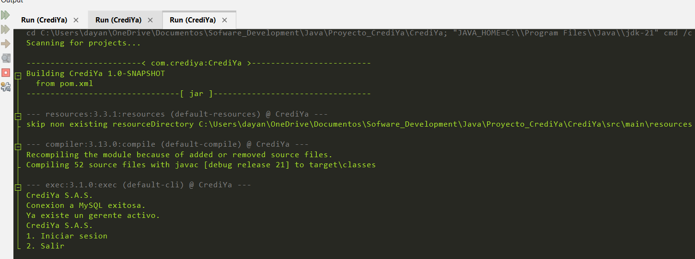

### Menu del gerente

Muestra el menu completo del gerente, incluyendo empleados, clientes, prestamos, pagos, reportes y respaldos.

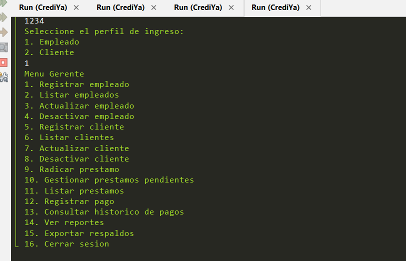

### Radicacion y calculo del prestamo

Muestra un prestamo radicado 

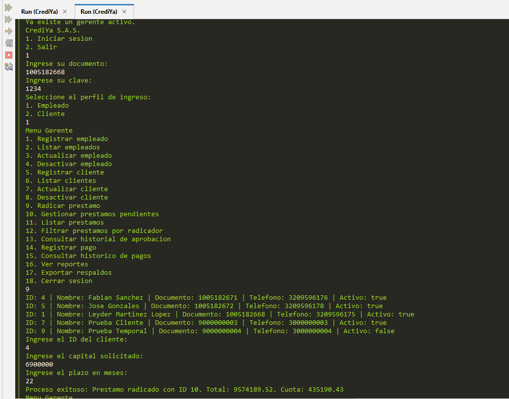

### Aprobacion por cadena de responsabilidad

Muestra un prestamo aprobado por asesor, supervisor o gerente, segun su monto.

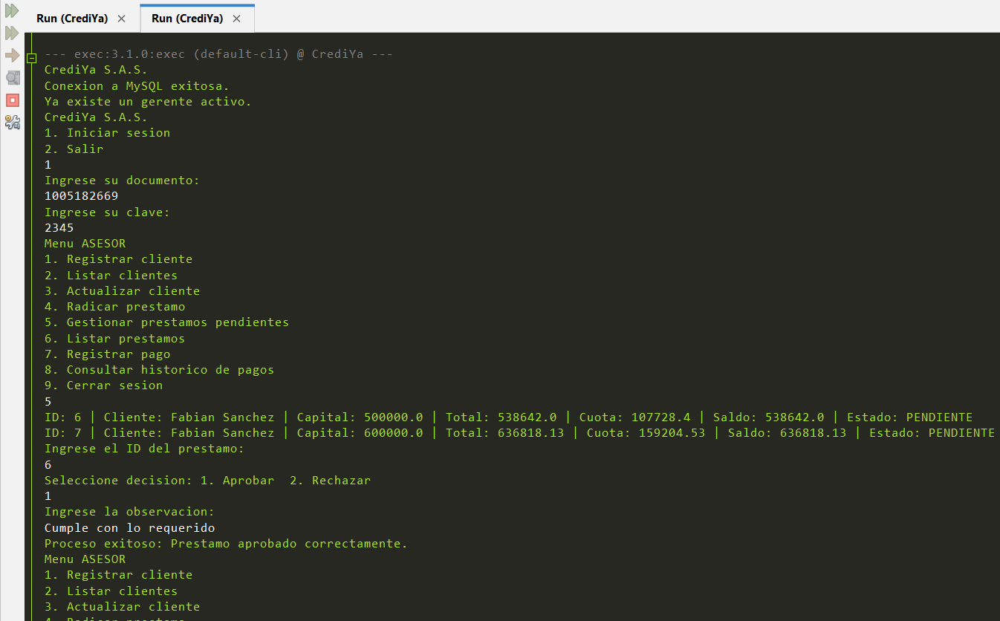
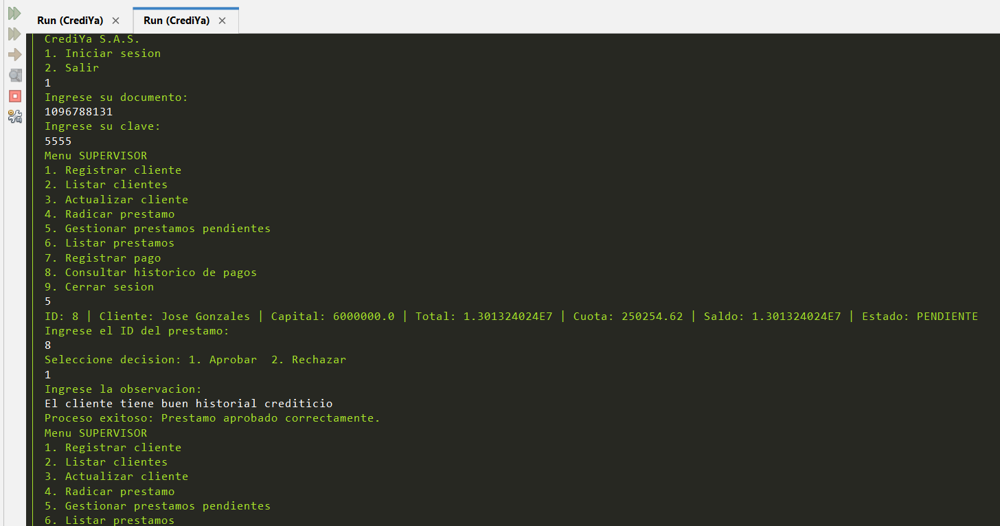
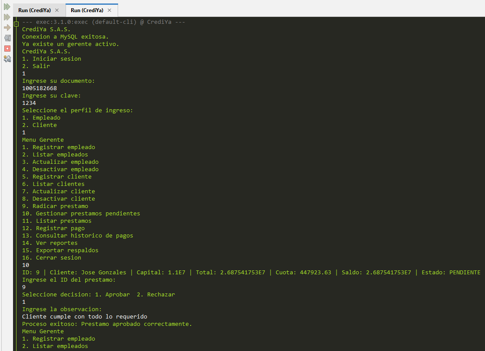


### Historial de aprobacion


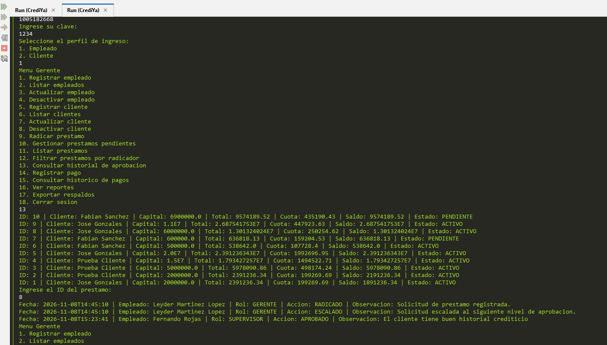

### Pago mixto

Muestra un pago con efectivo y transferencia, incluyendo el tipo de transferencia y la referencia.

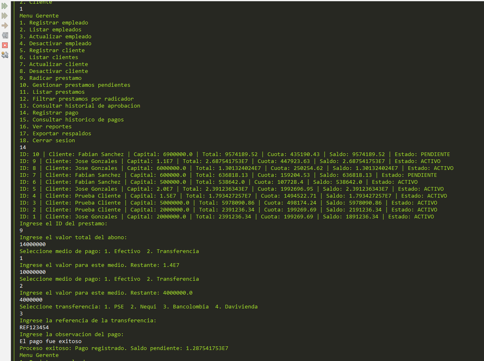

### Vista del cliente

Muestra el menu del cliente con sus consultas de informacion, prestamos y pagos.

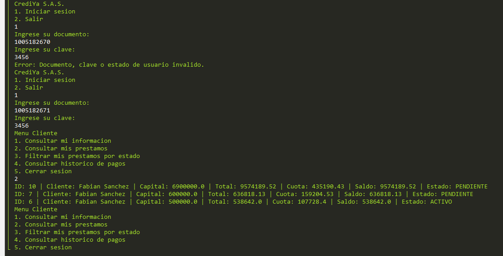

### Reportes

Muestra alguno de los reportes: prestamos activos, total prestado, recaudo o saldo de cartera.

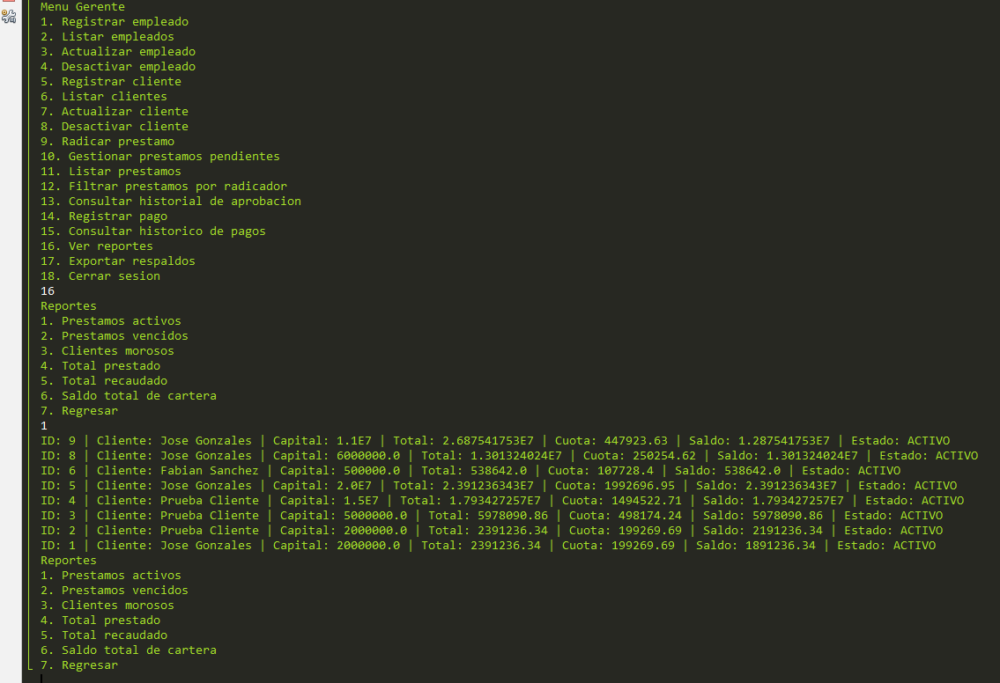

### Base de datos

Muestra las tablas de `crediya_db` desde MySQL Workbench.

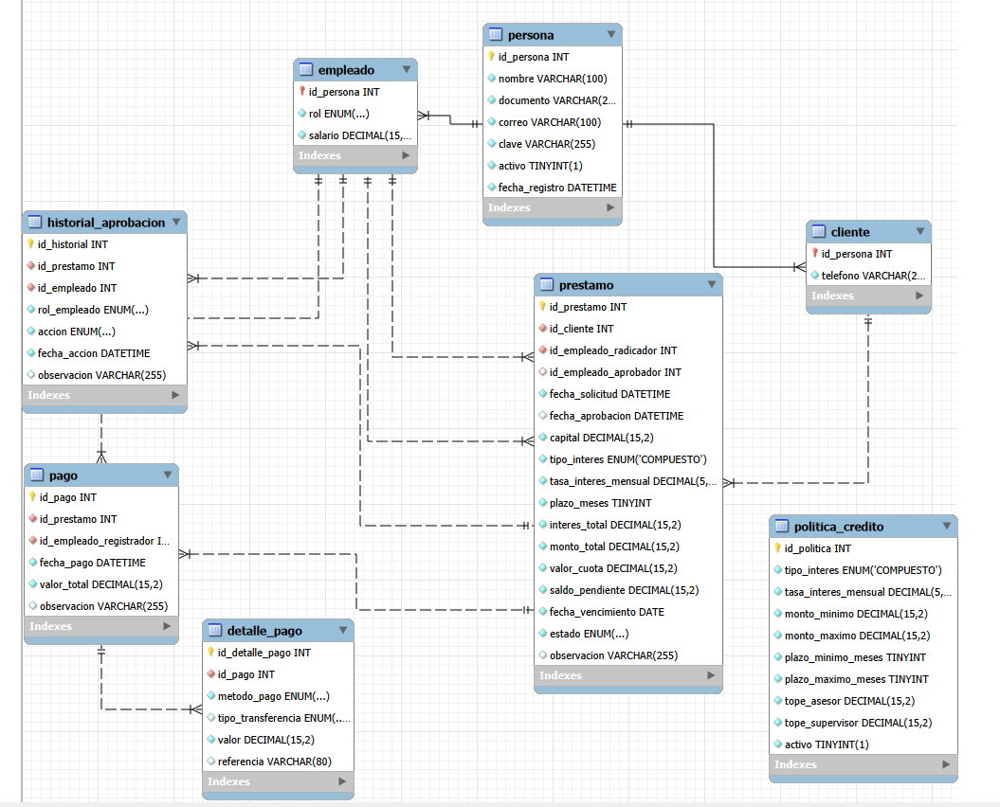

## Requisitos e instalacion

### Requisitos

- JDK 21 o superior.
- Apache Maven.
- MySQL Server 8 o superior.
- NetBeans o cualquier IDE compatible con Maven.

### 1. Clonar el repositorio

```bash
git clone https://github.com/LeyderJoseph/Proyecto_CrediYa.git
cd Proyecto_CrediYa
```

### 2. Crear la base de datos

1. Abre MySQL Workbench.
2. Ejecuta el script ubicado en `database/crediya_db.sql`.
3. Verifica que se haya creado la base de datos `crediya_db`.

### 3. Configurar la conexion

Abre el archivo:

```text
CrediYa/src/main/java/database/Conexion.java
```

Configura tu usuario y clave local de MySQL:

```java
private final String usuario = "root";
private final String clave = "TU_CLAVE_MYSQL";
```

> Nunca publiques una clave real de MySQL en un repositorio publico.

### 4. Ejecutar el proyecto

En NetBeans:

1. Selecciona **File > Open Project**.
2. Abre la carpeta `CrediYa`.
3. Ejecuta **Clean and Build**.
4. Pulsa **Run Project**.

Tambien puedes ejecutar con Maven:

```bash
cd CrediYa
mvn clean package
mvn exec:java
```

## Uso

1. Al ejecutar, el sistema comprueba la conexion con MySQL.
2. Si no existe un gerente activo, solicita registrar el gerente inicial.
3. Inicia sesion con documento y clave.
4. El sistema muestra el menu correspondiente al perfil seleccionado.
5. Registra clientes, radica prestamos, gestiona aprobaciones y registra pagos.
6. Como gerente, consulta reportes y exporta respaldos serializados.

## Patrones y conceptos aplicados

| Concepto o patron | Implementacion |
|---|---|
| POO | Clases del dominio: Persona, Empleado, Cliente, Prestamo y Pago |
| Herencia | Empleado y Cliente heredan de Persona |
| Polimorfismo | `getTipoPerfil()` tiene implementaciones diferentes en cada perfil |
| Encapsulamiento | Atributos privados, getters y setters |
| Singleton | `Conexion` mantiene una unica configuracion de acceso a MySQL |
| Chain of Responsibility | Asesor -> Supervisor -> Gerente para aprobar creditos |
| MVC | Separacion en `model`, `view` y `controller` |
| DAO | Clases DAO separan las consultas SQL de la logica del sistema |
| Serializable | Exportacion de respaldos `.dat` |
| Stream API y Lambda | Filtros de prestamos y calculos de reportes |
| Manejo de excepciones | Control de errores en conexion y operaciones de base de datos |

## Estructura del proyecto

```text
Proyecto_CrediYa/
├── CrediYa/
│   ├── src/main/java/
│   │   ├── com/crediya/       # Clase principal
│   │   ├── controller/        # Coordinacion de casos de uso
│   │   ├── dao/               # Acceso a MySQL
│   │   ├── database/          # Conexion Singleton
│   │   ├── model/             # Entidades y enums
│   │   ├── service/           # Respaldo y aprobacion
│   │   └── view/              # Menus, ingreso, impresion y validaciones
│   └── pom.xml
├── database/
│   └── crediya_db.sql
├── docs/
│   └── images/                # Capturas del sistema
├── .gitignore
└── README.md
```

## Autores

- Leyder Joseph Martinez Lopez